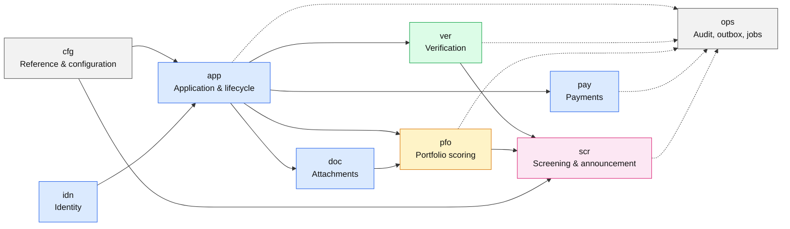
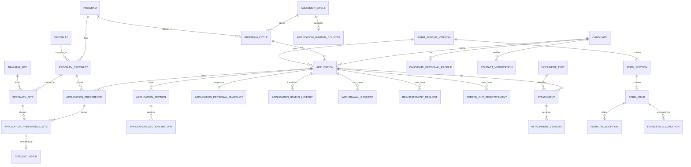
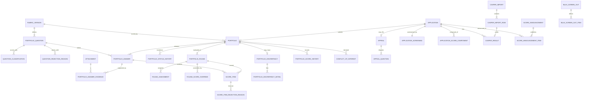
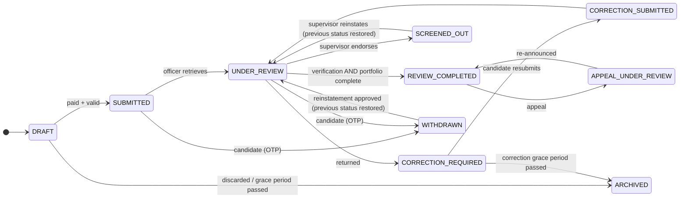
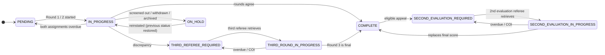

# Logical Data Model — MBRU Unified Admission Platform (GME Release 5)

Scope: the 60 user stories in [Stories_Addmission_System_BRD.md](../../BRD/Stories_Addmission_System_BRD.md), aligned to the [API contract](../../Contracts/openapi/openapi.yaml). Decisions D-01 to D-21 of 2026-11-11 are in [Open-Questions.md](../../Open-Questions.md); where the contract and this model differ, the contract decides what an operation does and the database follows (D-21). EF Core migrations are the schema of record; the physical scripts are the reference design (D-01). Interviews, shortlisting/ranking, offers and MBBS are out of scope and are not modelled. The physical implementation (SQL Server 2025) is in [../Physical](../Physical/README.md).

## Modelling principles

| # | Principle | Source |
|---|---|---|
| 1 | One bounded context per schema; cross-context links are by key, not by shared tables. | Contract §2 ownership |
| 2 | Verification, portfolio and payment are **separate status profiles**; the application status is derived from them, never merged with them. | BRD US-3.3.4 notes 2–4 |
| 3 | Approved business configuration (form schema, rubric, GPA conversion, weights, fees) is **versioned and effective-dated**; transactions pin the version they used. | Contract §7 gates |
| 4 | Submitted portfolio, referee scores, audit events and payment bindings are **immutable / append-only**. | US-1.3.10, US-3.3.4, Contract §6 |
| 5 | Referees never reach candidate identity: they use an anonymised view only. | decisions.md "Data and privacy" |
| 6 | Credentials, OTPs, card data and file binaries are **not stored**: IDAM, OTP provider, payment gateway and FileNet own them. | decisions.md, Contract §4 |
| 7 | Candidate-visible scores exist only through announcement snapshots. | US-4.3.1/4.3.2 |
| 8 | Unresolved BRD decisions (formulas, due dates, fees, capacity) are configuration rows, never constants. | Contract §7 |
| 9 | Personal information belongs to the candidate, not the application; each submitted application keeps a snapshot. | D-10, D-15 |
| 10 | Times are UTC `datetimeoffset`; locally defined deadlines also keep their IANA time zone. | D-07 |
| 11 | The audit trail records who, what, when, role and client, never data values; personal-data old/new values go to a change history. | D-06, standard s.15 |

## Domain map

Solid arrows are foreign-key dependencies; dashed arrows are intentionally FK-free references (audit/outbox must outlive the record).

## 1. Catalog and application ERD

## 2. Verification, payment and identity ERD

```mermaid
erDiagram
  APPLICATION ||--o| VERIFICATION_CASE : verified_by
  VERIFICATION_CASE ||--o{ VERIFICATION_ASSIGNMENT : assigned
  STAFF_USER ||--o{ VERIFICATION_ASSIGNMENT : works
  WORK_POOL ||--o{ VERIFICATION_ASSIGNMENT : sourced_from
  VERIFICATION_CASE ||--o{ CORRECTION_REQUEST : returns
  VERIFICATION_CASE ||--o{ CORRECTION_FLAG : flags
  CORRECTION_REQUEST ||--o{ CORRECTION_FLAG : groups
  VERIFICATION_CASE ||--o{ VERIFICATION_NOTE : notes
  VERIFICATION_CASE ||--o{ CLARIFICATION_REQUEST : escalates
  VERIFICATION_CASE ||--o{ SCREEN_OUT_RECOMMENDATION : recommends
  VERIFICATION_CASE ||--o{ VERIFICATION_EVENT : logs

  APPLICATION ||--o{ PAYMENT_SESSION : pays_via
  FEE_SCHEDULE ||--o{ PAYMENT_SESSION : priced_by
  PAYMENT_SESSION ||--|| PAYMENT_PROVIDER_BINDING : bound_to
  PAYMENT_ROUTING_CONFIGURATION ||--o{ PAYMENT_PROVIDER_BINDING : selected_by
  PAYMENT_SESSION ||--o{ PAYMENT_GATEWAY_EVENT : receives
  PAYMENT_SESSION ||--o{ PAYMENT_RECONCILIATION : resolved_by

  STAFF_USER ||--o{ STAFF_ROLE_ASSIGNMENT : granted
  ACCESS_ROLE ||--o{ STAFF_ROLE_ASSIGNMENT : defines
  ACCESS_ROLE ||--o{ STAFF_USER : active_role
  CANDIDATE ||--o| STAFF_USER : same_person
  STAFF_USER ||--o{ STAFF_WORK_POOL : member_of
  WORK_POOL ||--o{ STAFF_WORK_POOL : staffed_by
  CANDIDATE ||--o{ DUPLICATE_ACCOUNT_PAIR : original
  CANDIDATE ||--o{ DUPLICATE_ACCOUNT_PAIR : duplicate
  CANDIDATE ||--o{ ICP_REFRESH_REQUEST : refreshed_by
  CANDIDATE ||--o{ CANDIDATE_CHANGE_HISTORY : changes
  ICP_REFRESH_REQUEST ||--o{ CANDIDATE_CHANGE_HISTORY : applies
  INTEGRATION_CLIENT ||--o{ INTEGRATION_CLIENT_PERMISSION : granted
```

## 3. Portfolio and screening ERD

## 4. State models

Independent profiles. `Application status` is a projection of the others plus candidate-initiated events. There is no `REINSTATED` status: an approved reinstatement (of a withdrawn application, US-2.5.2) or a supervisor's direct reinstatement (of a screened-out application, STP-2.5 rule 5) restores the statuses held before, read from the status histories. A draft cannot be withdrawn (US-1.2.1: Withdraw is hidden for Draft); it is discarded (archived) instead.

Withdrawal is allowed from any status except Draft, Withdrawn and Archived; the two withdrawal arrows stand for all of them. The reinstatement arrows show the usual case; the actual target is whatever status was held before.

Any status other than Complete can go On Hold, and returns to the status it had before (from `pfo.PortfolioStatusHistory`). Verification has the same On Hold rule (withdrawal or archiving), and each portfolio round can also be On Hold.

## 5. Entity catalogue

Keys: **PK** primary key, **AK** alternate key, **FK** foreign key. Every status/round code is a lookup or a `CHECK`, never free text.

### Reference and configuration (`cfg`)

| Entity | Purpose | Key business attributes | Notes |
|---|---|---|---|
| ApplicationStatus / VerificationStatus / PortfolioStatus / PortfolioRoundStatus / AnnouncementStatus / PaymentStatus | Status lookups equal to API enums | code, display name, sort, is-terminal | |
| PaymentProvider | E-Pay, Network International | code, enabled | Never exposed to candidates |
| ProgramCategory, Discipline | Certificate / Internship / Residency / Fellowship; medical, dental, pharmacy | code, name | |
| AdmissionCycle | Intake year | code `2026/2027`, start and end dates | AK: code. The start year prefixes the cycle's application numbers (D-19) |
| Program | Offered programme | code, name, category, max preferences (1 or 2), inherited-rules program | Certificate (Medical Laboratory) inherits Internship (Dental) |
| ProgramCycle | Program in a cycle | opens/closes at, grace-period end, time zone | Due dates are configurable (BRD conflicts); local deadlines keep their IANA zone (D-07) |
| Specialty, ProgramSpecialty | Specialty and its program mapping | code, name | Only active specialties with active sites are offered |
| TrainingSite, SpecialtySite | Site and its specialty mapping | code, name, capacity (TBC) | |
| Country, University, Degree, ProgramDegree | Academic reference data | UAE flag, "Other" flag | UAE flag drives GPA input path |
| ReasonCategory, ReasonCode | Reason catalogue | code, candidate-safe message, sort order | Categories = API lookup types: WITHDRAWAL_REASON, CORRECTION_NOTE_TEMPLATE, SCREEN_OUT_REASON (10 BRD reasons), REINSTATEMENT_REJECTION_REASON (list open, OQ-04) |
| DocumentType | Uploadable document types | code, name, allowed media types, max size | Drives attachment-slot validation |
| WorkPool | Verification / referee pools | type, program cycle, specialty, retrieval cap | |
| WorkingCalendarDay, SystemParameter | Working-day calendar and tunables | | Drives overdue and reminder jobs |
| GpaConversionSet / Band | Scale-of-4 to percentage rubric | version, bands | Approval-gated |
| ScoringWeightSet / Item | Per-program weights per component | version, max points | Stamped on every computed score |

### Identity (`idn`)

| Entity | Purpose | Notes |
|---|---|---|
| Candidate | Platform candidate | Matched to IDAM by the IDAM immutable user id; 9-digit text candidate number from `000000001` (D-05, D-13); IDAM-registered e-mail and mobile; Emirates ID, passport and mobile **hashes** for duplicate detection (not unique) |
| CandidatePersonalProfile | Personal information of the candidate (US-1.3.3), 1:1 | Identity, documents, contact, next of kin, ICP-sourced field list; per candidate, not per application (D-10) |
| DuplicateAccountPair | Accounts that match on Emirates ID, passport or mobile (US-1.1.1) | Matched attributes only, never values; supervisor report |
| StaffUser, AccessRole, StaffRoleAssignment | Staff and scoped roles | Separate from candidates (D-04); IDAM user id; active role (role switcher); UUID link to the same person's candidate record (D-14); role plus program/specialty scope, null scope = all |
| StaffWorkPool | Staff membership of work pools | Target officer/referee lists and referee eligibility |
| IntegrationClient, IntegrationClientPermission | Service-to-service callers (standard s.15) | IDAM client id; permissions such as `payments.events-write` |
| IcpRefreshRequest | Supervisor preview/apply of ICP data (US-2.5.3) | Reason, hashed single-use preview token, expiry, applied fields, stale-preview check |
| CandidateChangeHistory | Old and new values of personal-data changes (D-06) | Source ICP_REFRESH, CANDIDATE_EDIT or STAFF_CORRECTION; the audit log never holds values |

### Application (`app`) and documents (`doc`)

| Entity | Purpose | Notes |
|---|---|---|
| FormSchemaVersion → FormSection → FormField → FormFieldOption / FormFieldCondition | Versioned, program-configured form definition | Mirrors `FormFieldDefinition`; conditions use the contract operators |
| ApplicationNumberCounter | Per-cycle counter for application numbers | Atomic increment; numbers never reused |
| Application | Aggregate root | Application number `<cycle start year><7-digit counter>`, e.g. `20270000001` (D-19); version for ETag; pinned form schema; one live application per candidate per program cycle |
| ApplicationPersonalSnapshot | Personal information as submitted (D-15) | Taken at submission; never changed afterwards |
| ApplicationPreference, ApplicationPreferenceSite | Ranked specialties and ordered sites | Site must belong to the chosen specialty; no duplicate site or specialty |
| SiteExclusion | Site dropped after selection (US-1.2.8) | Mandatory free-text reason (max 500) |
| ApplicationSection (+History) | Section values as JSON, versioned | Eight section keys from the contract; personal information is not held here (D-10) |
| ApplicationStatusHistory | Every status transition | |
| WithdrawalRequest | Reason + OTP confirmation reference (US-1.2.4) | Reason from WITHDRAWAL_REASON, free text when OTHER; OTP held by provider; resend cooldown tracked |
| ReinstatementRequest | Candidate request to reinstate a **withdrawn** application, and the supervisor decision | Justification only (max 1000); SUBMITTED / APPROVED / REJECTED; one open request per application; rejection needs a reason |
| ScreenOutReinstatement | Supervisor's direct reinstatement of a **screened-out** application (STP-2.5 rule 5) | Justification; the statuses restored |
| ContactVerification | OTP check of a changed contact e-mail or mobile (US-1.3.3 AC11) | Value hash only; validity window |
| Attachment, AttachmentVersion | File metadata and immutable versions | Document type; binary in FileNet via Rhapsody with storage status (PENDING, STORED, FAILED, PURGED); scan status, hash; staff replacement adds a version |

### Payment (`pay`)

| Entity | Purpose | Notes |
|---|---|---|
| FeeSchedule | Fee per program cycle and type | AED only; approval-gated |
| PaymentRoutingConfiguration | Server-side provider routing | Versioned |
| PaymentSession | Candidate payment attempt | Amount snapshot; idempotency key; at most one paid and one open per fee |
| PaymentProviderBinding | Immutable provider and routing version per session | |
| PaymentGatewayEvent | Normalised callback event | Unique on provider + event id |
| PaymentReconciliation | Resolution of unknown states | Original provider only; no cross-provider failover |

### Verification (`ver`)

| Entity | Purpose | Notes |
|---|---|---|
| VerificationCase | One per submitted application | Own status profile |
| VerificationAssignment | Officer ownership history | One current assignment; pool, retrieved/due time, end reason, supervisor justification |
| CorrectionRequest, CorrectionFlag | Items returned to the candidate | Flags point into section JSON; candidate edits only flagged fields |
| VerificationNote, ClarificationRequest | Officer notes; supervisor clarification loop | |
| ScreenOutRecommendation | Officer recommendation and supervisor decision | Decider ≠ recommender; ENDORSE_SCREEN_OUT / REJECT_SCREEN_OUT; note required on rejection; endorsement may change the reason |
| VerificationEvent | Case timeline | |

### Portfolio (`pfo`)

| Entity | Purpose | Notes |
|---|---|---|
| RubricVersion, PortfolioQuestion, QuestionClassification, QuestionRejectionReason | Versioned rubric | Scoring type: all-or-nothing or points system |
| Portfolio, PortfolioAnswer, PortfolioAnswerEvidence | One-time candidate submission | Immutable after submission |
| PortfolioStatusHistory | Every portfolio status change | Restores the status after On Hold |
| PortfolioRound, RoundAssignment | Round 1, 2, 3 and second evaluation; referee assignment | A referee takes one round per portfolio; no assignment after a COI; retrieved/due time and end reason |
| RoundScoreOverride | Senior-referee override of a round total (US-3.2.2) | Mandatory justification; round total vs per-question is open (OQ-06) |
| ConflictOfInterest | Referee COI declarations | Mandatory free-text reason (max 500) |
| ScoreItem, ScoreItemRejectionReason | Per-question referee result | Reject ⇒ zero points |
| PortfolioDiscrepancy (+Detail) | Round 1 vs Round 2 differences | Separate from any status |
| PortfolioScoreHistory | Every computed score; latest final row is effective | |
| Appeal, AppealQuestion | One appeal per application | Questions under dispute; candidate response max 200 |

### Screening (`scr`)

| Entity | Purpose | Notes |
|---|---|---|
| ApplicationScreening | Current score summary, CASPER attendance and announcement status | |
| ApplicationScoreComponent | GPA, exam, portfolio, CASPER components with weight-set version | One current row per component |
| CasperImport, CasperImportRow, CasperResult | Versioned upload, raw rows, applied result | Raw data stored as received; the Application ID is read as text and matched on its digits (D-19) |
| ScoreAnnouncement, ScoreAnnouncementItem | Initial and re-announcement snapshots | Candidate sees only these |
| BulkScreenOut, BulkScreenOutItem | Bulk action and per-application outcome | Opens no appeal window |

### Operations (`ops`)

| Entity | Purpose |
|---|---|
| AuditEvent | Append-only audit trail (no FKs, no payloads, no data values); records the active role and the integration client |
| IdempotencyKey | `Idempotency-Key` replay and reuse detection |
| DomainEventOutbox | Transactional outbox for the versioned domain events |
| NotificationTemplate, NotificationOutbox | Templates and de-duplicated delivery queue |
| ScheduledJobRun | History of jobs run in-process by a `BackgroundService` (D-18) |

## 6. Story coverage by domain

| Epic | Feature | Main entities |
|---|---|---|
| EPIC-01 | STP-1.1 Account and login | Candidate, DuplicateAccountPair |
| EPIC-01 | STP-1.2 Dashboard and lifecycle | Application, ApplicationStatusHistory, WithdrawalRequest, ReinstatementRequest, Appeal, SiteExclusion |
| EPIC-01 | STP-1.3 Prepare and submit | ProgramCycle, ApplicationNumberCounter, ApplicationPreference(Site), FormSchemaVersion…, ApplicationSection, CandidatePersonalProfile, ContactVerification, ApplicationPersonalSnapshot, Attachment, DocumentType, Portfolio…, PaymentSession…, FeeSchedule |
| EPIC-02 | STP-2.1 – 2.5 Verification | WorkPool, StaffWorkPool, VerificationCase, VerificationAssignment, CorrectionFlag, ClarificationRequest, ScreenOutRecommendation, ReinstatementRequest, ScreenOutReinstatement, IcpRefreshRequest, CandidateChangeHistory |
| EPIC-03 | STP-3.1 – 3.3 Portfolio scoring | RubricVersion…, PortfolioStatusHistory, PortfolioRound, RoundAssignment, RoundScoreOverride, ConflictOfInterest, ScoreItem, PortfolioDiscrepancy, PortfolioScoreHistory |
| EPIC-04 | STP-4.1 – 4.5 Screening | ApplicationScreening, ApplicationScoreComponent, CasperImport…, ScoreAnnouncement…, BulkScreenOut… |

## 7. Open decisions that affect the model

| # | Decision | Where it lands | Default used |
|---|---|---|---|
| 1 | Active-application rule per candidate | Filtered unique index on `app.Application` | One live application per candidate per program cycle |
| 2 | GPA, exam, CASPER, portfolio formulas and weights | `cfg.ScoringWeight*`, `cfg.GpaConversion*` | Tables only; no formula in SQL |
| 3 | Due dates and reminder/archive cadence | `cfg.SystemParameter`, `cfg.WorkingCalendarDay` | Empty until approved |
| 4 | Site capacity | `cfg.SpecialtySite.Capacity` | Nullable |
| 5 | Fee amounts and refund rules | `pay.FeeSchedule` | Empty until approved; refunds not modelled |
| 6 | Retention, deletion and data classification | Not modelled | Decide before production |
| 7 | Per-field encryption / masking of PII | Physical layer | See the Physical README |
| 8 | Interview, shortlisting, offers | Not modelled | Needs a separately approved BRD |
| 9 | Reinstatement rejection reasons (OQ-04) | `cfg.ReasonCode` category REINSTATEMENT_REJECTION_REASON | Category seeded, no codes |
| 10 | Officer screen-out note mandatory or not (OQ-05) | `ver.ScreenOutRecommendation.Justification` | Optional |
| 11 | Score override on round total or per question (OQ-06) | `pfo.RoundScoreOverride` | Round total |
| 12 | FileNet timing and orphan rules (OQ-07) | `doc.AttachmentVersion.StorageStatusCode`, job `document-orphan-cleanup` | Placeholder |
