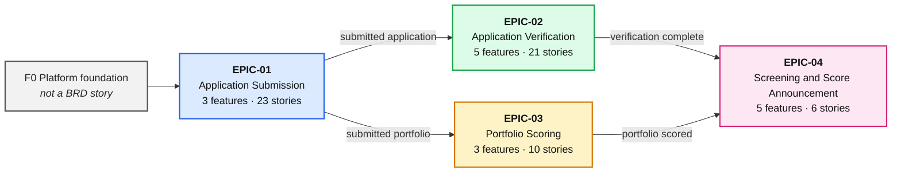
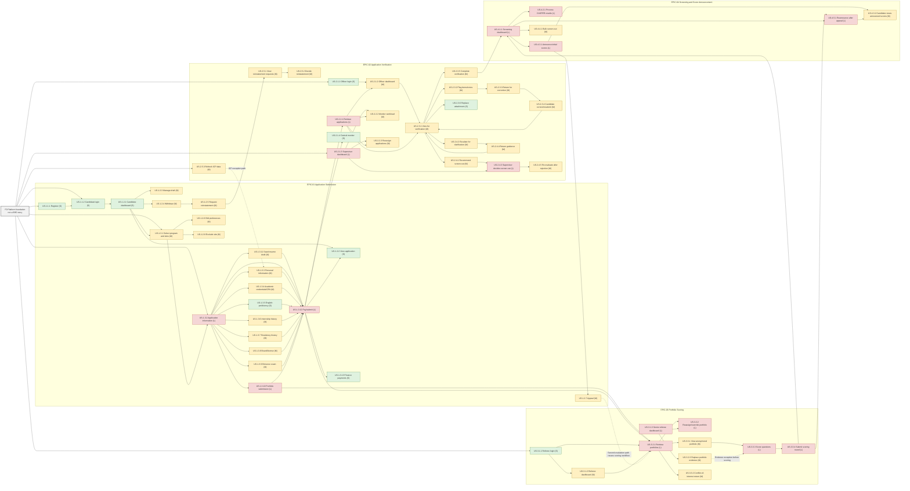

# User-Story Dependencies and Demo Roadmap

This map turns the GME Release 5 stories in the S/M/L backlog into a suggested delivery sequence. It is a planning view, not a change to the BRD or a mandate to build one long branch.

## Reading the map

- **A → B** means B needs A's outcome, state, contract, or data to be available before B can be completed and demonstrated. It does not always mean A and B cannot be developed in parallel after their contract is agreed.
- **Foundation** is an enabling work package, not a BRD user story. It must be planned and demoed with a real user journey; infrastructure alone is not the first product demo.
- Some sequencing is logically inferred from the business process and story descriptions. Confirm it with the product owner and technical leads during refinement.
- The size labels (S/M/L) are the current relative estimates from the story folders. L stories remain candidates for further decomposition.
- Mermaid map includes every BRD story ID. Dashed edge indicates a shared/conditional capability, not a hard serial dependency.

## Epic overview

Four epics, 16 features, and 60 user stories. T-shirt sizes come from the S/M/L story folders; no story is currently sized XL/XXL.

### Epic summary

| Epic | Features | Stories | S | M | L |
|---|---:|---:|---:|---:|---:|
| EPIC-01 Application Submission | 3 | 23 | 6 | 14 | 3 |
| EPIC-02 Application Verification | 5 | 21 | 3 | 15 | 3 |
| EPIC-03 Portfolio Scoring | 3 | 10 | 1 | 4 | 5 |
| EPIC-04 Screening and Score Announcement | 5 | 6 | 0 | 2 | 4 |
| **Total** | **16** | **60** | **10** | **35** | **15** |

### Epic → Feature → Story breakdown

| Epic | Feature | Stories | S | M | L |
|---|---|---:|---:|---:|---:|
| **EPIC-01 Application Submission** | STP-1.1 Create Account and Login | 2 | 2 | 0 | 0 |
|  | STP-1.2 Access and View Dashboard | 8 | 2 | 6 | 0 |
|  | STP-1.3 Prepare and Submit Application | 13 | 2 | 8 | 3 |
| **EPIC-02 Application Verification** | STP-2.1 Access and View Dashboards | 4 | 2 | 1 | 1 |
|  | STP-2.2 Retrieve and Manage Applications from Pool | 3 | 0 | 2 | 1 |
|  | STP-2.3 Review and Verify Application | 6 | 1 | 5 | 0 |
|  | STP-2.4 Escalate and Screen Out Application | 5 | 0 | 4 | 1 |
|  | STP-2.5 Process Reinstatement Requests | 3 | 0 | 3 | 0 |
| **EPIC-03 Portfolio Scoring** | STP-3.1 Access and View Referee Dashboard | 3 | 1 | 1 | 1 |
|  | STP-3.2 Retrieve and Manage Portfolios from Pool | 3 | 0 | 1 | 2 |
|  | STP-3.3 Review and Score Portfolio | 4 | 0 | 2 | 2 |
| **EPIC-04 Screening and Score Announcement** | STP-4.1 Access and Monitor Screening Dashboard | 1 | 0 | 0 | 1 |
|  | STP-4.2 Upload and Process CASPER Results | 1 | 0 | 0 | 1 |
|  | STP-4.3 Announce Initial Screening Scores | 2 | 0 | 1 | 1 |
|  | STP-4.4 Bulk Screen Out Applications | 1 | 0 | 1 | 0 |
|  | STP-4.5 Reannounce Scores After Portfolio Appeal | 1 | 0 | 0 | 1 |

### Story-level sizing

| Epic | Feature | Story | Size |
|---|---|---|:---:|
| EPIC-01 | STP-1.1 | US-1.1.1 Register, US-1.1.2 Candidate login | S, S |
| EPIC-01 | STP-1.2 | US-1.2.1 Candidate dashboard, US-1.2.2 View application | S, S |
| EPIC-01 | STP-1.2 | US-1.2.3 Manage draft, US-1.2.4 Withdraw, US-1.2.5 Request reinstatement, US-1.2.6 Edit preferences, US-1.2.7 Appeal, US-1.2.8 Exclude site | M ×6 |
| EPIC-01 | STP-1.3 | US-1.3.5 English proficiency, US-1.3.13 Finance payments | S, S |
| EPIC-01 | STP-1.3 | US-1.3.1 Select program and sites, US-1.3.3 Personal information, US-1.3.4 Academic credentials/GPA, US-1.3.6 Internship history, US-1.3.7 Residency history, US-1.3.8 Board/license, US-1.3.9 Entrance exam, US-1.3.11 Save/resume draft | M ×8 |
| EPIC-01 | STP-1.3 | US-1.3.2 Application information, US-1.3.10 Portfolio submission, US-1.3.12 Pay/submit | L ×3 |
| EPIC-02 | STP-2.1 | US-2.1.1 Officer login, US-2.1.4 Central monitor | S, S |
| EPIC-02 | STP-2.1 | US-2.1.2 Officer dashboard | M |
| EPIC-02 | STP-2.1 | US-2.1.3 Supervisor dashboard | L |
| EPIC-02 | STP-2.2 | US-2.2.2 Monitor workload, US-2.2.3 Reassign applications | M, M |
| EPIC-02 | STP-2.2 | US-2.2.1 Retrieve applications | L |
| EPIC-02 | STP-2.3 | US-2.3.6 Replace attachment | S |
| EPIC-02 | STP-2.3 | US-2.3.1 View for verification, US-2.3.2 Flag items/notes, US-2.3.3 Return for correction, US-2.3.4 Candidate correct/resubmit, US-2.3.5 Complete verification | M ×5 |
| EPIC-02 | STP-2.4 | US-2.4.1 Recommend screen-out, US-2.4.2 Escalate for clarification, US-2.4.4 Return guidance, US-2.4.5 Re-evaluate after rejection | M ×4 |
| EPIC-02 | STP-2.4 | US-2.4.3 Supervisor decides screen-out | L |
| EPIC-02 | STP-2.5 | US-2.5.1 View reinstatement requests, US-2.5.2 Decide reinstatement, US-2.5.3 Refresh ICP data | M ×3 |
| EPIC-03 | STP-3.1 | US-3.1.1 Referee login | S |
| EPIC-03 | STP-3.1 | US-3.1.2 Referee dashboard | M |
| EPIC-03 | STP-3.1 | US-3.1.3 Senior referee dashboard | L |
| EPIC-03 | STP-3.2 | US-3.2.3 Replace portfolio evidence | M |
| EPIC-03 | STP-3.2 | US-3.2.1 Retrieve portfolios, US-3.2.2 Reassign/override portfolio | L, L |
| EPIC-03 | STP-3.3 | US-3.3.1 View anonymized portfolio, US-3.3.2 Conflict-of-interest return | M, M |
| EPIC-03 | STP-3.3 | US-3.3.3 Score questions, US-3.3.4 Submit scoring round | L, L |
| EPIC-04 | STP-4.1 | US-4.1.1 Screening dashboard | L |
| EPIC-04 | STP-4.2 | US-4.2.1 Process CASPER results | L |
| EPIC-04 | STP-4.3 | US-4.3.2 Candidate views announced scores | M |
| EPIC-04 | STP-4.3 | US-4.3.1 Announce initial scores | L |
| EPIC-04 | STP-4.4 | US-4.4.1 Bulk screen-out | M |
| EPIC-04 | STP-4.5 | US-4.5.1 Reannounce after appeal | L |

## Recommended delivery sequence

| Increment | Build and demo | Why this is the next useful increment |
|---|---|---|
| **F0 — Thin platform foundation** | Agree and implement the smallest usable identity/role integration, application and state model, cycle/program/reference-data configuration, audit/error handling, notification boundary, and document-storage boundary. Use synthetic data. | This is foundational and touches many stories, but do not spend a release building generic infrastructure without a user-visible slice. Establish contracts early to prevent cross-team conflicts. |
| **D1 — First demo: candidate starts and saves a draft (MVP slice)** | **US-1.1.1 → US-1.1.2 → US-1.2.1 → US-1.3.1 → first child slice of US-1.3.2 → first child slice of US-1.3.11.** Demo candidate registration/login, program/specialty/site selection, a minimum valid application-information form, save/resume, and dashboard visibility. | This is the earliest coherent product demo: a real candidate outcome in a complete thin slice. A foundation-only demo proves technology, not admissions value. Restrict D1 to an approved minimum form, but implement persistence, authorization, validation, and tests end to end. |
| **D2 — Complete application and submit** | Add personal/academic and applicable program-specific sections (**US-1.3.3–US-1.3.10**), finalize draft behavior, then **US-1.3.12** payment/submission. Demo confirmed payment, submitted read-only application, receipt, and notification. | This exercises the broadest candidate-facing intake work and produces the application record consumed by staff workflows. Treat uncertain score formulas and payment reconciliation as explicit decisions, not assumptions. |
| **D3 — Verify submitted applications** | **US-2.1.1/2 → US-2.2.1 → US-2.3.1** and then correction (**US-2.3.2 → US-2.3.3 → US-2.3.4 → US-2.3.5**), plus escalation/screen-out/reinstatement paths (**US-2.4.* and US-2.5.*). Demo officer retrieval through a completed or corrected case with audit trail. | Delivers the next end-to-end workstream, while portfolio scoring can proceed in parallel once submitted immutable portfolio data and anonymization boundaries are ready. |
| **D4 — Score portfolios** | **US-3.1.1/2 → US-3.3.1 → US-3.2.1 → US-3.3.3 → US-3.3.4**, with senior-referee oversight and COI/reassignment paths. Demo independent anonymous scoring through agreed/discrepant results and final portfolio score. | This is a separate parallel review stream. It must not expose candidate identity to referees or block verification on unrelated work. Rubrics, discrepancy rules, and score weights must be approved first. |
| **D5 — Publish results** | When verification and portfolio scoring are both complete: **US-4.1.1 → US-4.3.1 → US-4.3.2**. Add CASPER import and bulk screen-out as separately demoable paths. Add appeal/re-evaluation/reannouncement using **US-1.2.7 → US-3.2.1/US-3.3.3/US-3.3.4 → US-4.5.1**. | Completes the Release 5 journey from application to candidate-visible announced scores. This is the broadest end-to-end coverage in the supplied BRD. Interviews, shortlisting, offers, and enrollment are not part of this release backlog. |

### First demo versus most work covered

- **First demo:** D1, candidate creates and saves an application draft. It should be prioritized ahead of large staff dashboards because it validates the core applicant journey and shared application model early.
- **Most Release 5 work covered:** D5, the complete intake, parallel verification/portfolio workstreams, and score announcement. D5 is a program milestone, not a single story or a safe single PR.
- **Largest early enabler:** F0, which should be owned and delivered as thin contracts and capabilities alongside D1. Do not make all downstream stories wait for a speculative, generalized platform foundation.
- **Refine before D1:** Split US-1.3.2 into a minimum application-information slice and follow-on conditional form/evidence slices. Split US-1.3.11 into core save/resume and later auto-save, reminders, and archive slices. The initial demo must not claim either whole BRD story is complete unless all of its acceptance criteria are met.

## Dependency map

## Important dependency interpretation

1. **Foundation does not mean “build a complete shared platform first.”** Implement identity, authorization, state persistence, configuration, audit, notifications, and document/payment adapters just far enough for the D1 candidate draft demo. Keep contracts backward-compatible and evolve them with the slices.
2. **Candidate sections can progress in parallel after US-1.3.1/US-1.3.2 contracts are fixed.** They do not all need to be one serial chain; the diagram joins them at application submission because completion is required before US-1.3.12.
3. **Verification and portfolio scoring are parallel after submission.** Review completion and score announcement require both workstreams; one must not be modeled as blocking the other.
4. **D1 is deliberately smaller than “all application intake.”** It proves identity through a saved draft. D2 grows it into a complete paid submission. This lets the team demo value before the high-complexity scoring and back-office flows are complete.
5. **Dashboard stories are consumers of capabilities.** Build a minimal useful dashboard with each slice; do not make a full dashboard a gate for the workflow behind it.
6. **Interviews are not mapped.** They are mentioned as future/out-of-scope work in the source BRD and require their own approved stories.
7. **CASPER processing does not gate initial announcement.** The BRD states that candidates with completed verification and portfolio scoring may be announced independently; CASPER results update attendance and shortlisting data separately.

## Suggested parallel ownership without merge conflicts

- **Candidate journey owner:** US-1.1.* and US-1.2.*; coordinate shared dashboard and lifecycle contracts.
- **Application form owner:** US-1.3.*; agree on form schema, evidence model, and validation/config API before splitting individual sections.
- **Verification owner:** US-2.*; agree on state transitions and assignment API; separate candidate correction UI from officer review UI after that contract is stable.
- **Portfolio owner:** US-3.*; own anonymization, round model, rubric version, and assignment contract. Do not concurrently change the shared application status model without coordination.
- **Screening/reporting owner:** US-4.* plus finance/central-monitor views where relevant; agree on score read model and announcement state contract.
- **Foundation/integration owner:** identity, payment, document storage, ICP, notifications, audit, reference data, and migration coordination. Prefer stable interfaces and independently reviewed changes to shared schemas.

Keep each story on a short-lived branch with one owner, contract-first parallel work, and a focused PR. Assign a single coordinator for shared state/schema changes and database migrations.
