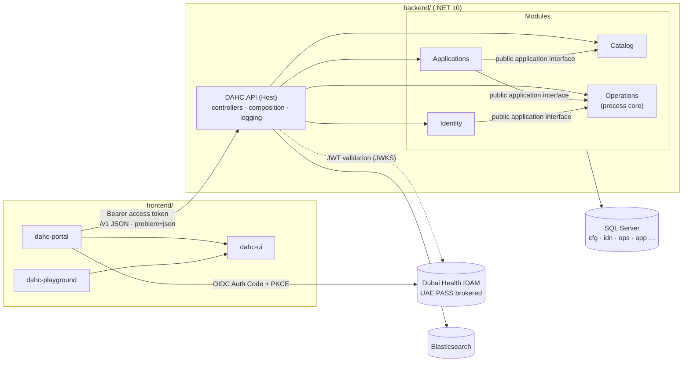

# DAHC Admissions Platform: Solution and Module Layout

Owner: Tech Lead | Status: **Draft, partly superseded** (see [§1](#1-decisions)) | Last reviewed: 2026-11-11

This file holds the solution and module layout. It was first written against `coding-standards.md`, which has been replaced by `dahc-engineering-standards (2).md`. Decisions D-01 to D-21 in [`Open-Questions.md`](../../Open-Questions.md) supersede parts of it; §1 lists them, and sections still showing the earlier design are marked **(superseded)**.

Order of authority (D-21):

| Source | What it decides here |
|---|---|
| `dahc-engineering-standards (2).md` (section 30 holds project decisions and approved deviations) | How code is built and how HTTP behaves: layering, response envelope, errors, authentication, time, logging, tests |
| `Contracts/` (OpenAPI 3.1 + `decisions.md` + end-to-end agreement) | What each operation does: endpoints, fields, business rules, roles per operation |
| EF Core model and migrations (D-01); `Database_Schema/Physical/` is the reference design | Tables, keys, constraints; the database follows the two sources above |
| `User_Stories/`, `BRD/` | Module scope and delivery order |

Rule for this document: a folder or file is listed only if the **first slice** needs it: sign-in, catalog discovery, draft creation, draft read/list and draft save. Later modules are catalogued in [§4.7](#47-later-modules-catalogue-only), and their files are created with their stories (no placeholder files).

---

## 1. Decisions

### 1.1 Current decisions (2026-11-11)

| # | Topic | Decision | Source |
|---|---|---|---|
| A1 | Project layout | One set of projects per business area: `DAHC.<Module>.<Layer>`, layers Domain ← Application ← Infrastructure ← Host, one Host `DAHC.API`. An approved deviation from the standard's single `DAHC.Core/Service/Data` layout, recorded in the standard's section 30. | D-17 |
| A2 | Data access | No repository or unit of work; services use the `DbContext` directly (standard s.10-11). **One `DahcDbContext`** for the whole solution, in a shared data project; each module contributes its own entity configurations. One migration history; audit and business writes share one transaction. This replaces the earlier one-context-per-module design. | D-22, standard s.11 |
| A3 | Validation | Data annotations on request records give `400`; business rules return results that become `422`. No FluentValidation. | Standard s.10 |
| A4 | Tests | Only tests that protect business, security, validation, concurrency or integration behaviour. | Standard s.18 |
| A5 | Test database | **Changed:** data tests use the EF Core in-memory provider, a new database per test. Constraints, row versions, transactions and SQL translation are checked in review and on staging against SQL Server. No Testcontainers. | D-16 |
| A6 | Response translation | Services return results; controllers translate them with one shared method into the `ApiResponse<T>` envelope or a top-level ProblemDetails. | Standard s.12, D-02 |
| A7 | Schema of record | **Changed:** EF Core code-first migrations, applied explicitly at deployment, never at startup. `Database_Schema/Physical/*.sql` is the reference design the model is built from. | D-01 |
| A8 | Authentication | **Changed:** opaque IDAM access tokens validated by introspection; roles are internal; `AuthController` exposes `POST /api/v1/auth/sign-in`, `GET /api/v1/auth/me` and `PUT /api/v1/auth/active-role`. Candidates and staff are separate records; staff can hold several roles with one active role. | D-03, D-04, standard s.15 |
| A9 | Response contract | **Changed:** `ApiResponse<T>` success envelope (`data`, `pagination` for lists, `messageCode` for empty lists); dotted error codes; downloads are not wrapped. | D-02 |
| A10 | Paths and IDs | `/api/v1`; cursor pagination (`limit`, `nextCursor`); UUIDs in URLs and payloads; candidate number (9 digits, text) and application number (`<cycle year><7 digits>`) are display fields. | D-05, D-12, D-13, D-19 |
| A11 | Time | `DateTimeOffset` in UTC stored as `datetimeoffset`; locally defined deadlines also store their IANA time zone; default `Asia/Dubai`, cultures `en-AE` and `ar-AE`. | D-07, standard s.14 |
| A12 | Background work | In-process `BackgroundService` driven by a scheduled-work table; no HTTP job triggers. | D-18 |
| A13 | Logging | Serilog in a `DAHC.Logging` project, as the standard requires (replaces the earlier choice to keep it in the Host). | Standard s.2 |
| A14 | Personal data | Stored per candidate; each submitted application keeps a snapshot. | D-10, D-15 |

### 1.2 Earlier conflicts and how they ended

| # | Earlier choice | Now |
|---|---|---|
| C1 | No `AuthController`; JWT validation with scopes | Superseded by A8 |
| C2 | Contract shapes without an envelope | Superseded by A9 |
| C3 | SQL scripts as the schema source, no EF migrations | Superseded by A7 |
| C4 | `long` keys internally, `PublicId` exposed | Kept (standard s.6: public GUIDs, integer keys internal) |
| C5 | Schema-driven form sections | Open: OQ-02 (dynamic form engine under standard s.10) |
| C6 | `/v1` | Superseded by A10 (`/api/v1`) |
| C7 | Serilog in the Host | Superseded by A13 |
| C8 | Hand-written DTOs until a generator is chosen | Open: OQ-08 (packages) |

### 1.3 Still open

OQ-02 (form schema), OQ-08 (packages), OQ-15 (IDAM items) and the business questions in [`Open-Questions.md`](../../Open-Questions.md).

### 1.4 Sections still showing the earlier design

These sections predate the decisions above and must be rewritten before scaffolding: §2.1 topology (JWT/JWKS arrow), §4.1 Host (`AuthenticationRegistration` with JwtBearer and scopes, `Scopes.cs`, `MeController`), §4.2 Identity (`CandidateProfileService` for `GET /v1/me`), §4.6 Tests (Testcontainers fixture), §6 packages (`Testcontainers.MsSql`), §7.2 translation (no envelope), §7.4 authentication (JWT), §7.6 test fixture and §8 scaffolding order. Each is marked **(superseded)** below.

---

## 2. Solution overview

### 2.1 Topology (superseded: JWT arrow, see A8)



### 2.2 Dependency rules (checked by `DAHC.API.Tests/Architecture`)

| From | May reference | Never |
|---|---|---|
| `DAHC.<M>.Domain` | BCL only | EF Core, ASP.NET Core, any other project |
| `DAHC.<M>.Application` | `DAHC.<M>.Domain`; **another module's `.Application` only** (its public interface) | Any `.Infrastructure`, any other module's `.Domain`, EF Core |
| `DAHC.<M>.Infrastructure` | `DAHC.<M>.Application`, `DAHC.<M>.Domain`, EF Core | Another module's `.Infrastructure` or `DbContext` |
| `DAHC.API` | Every `.Application` and `.Infrastructure` (composition root) | Any `DbContext` outside `Composition/` |

Cross-module foreign keys, such as `app.Application.CandidateId → idn.Candidate`, are plain `long` columns in the owning module's `DbContext`. There are no navigations across modules.

### 2.3 Modules

| Module | DB schema | Contract file(s) | Stories | First slice? |
|---|---|---|---|---|
| `Identity` | `idn` | `identity.yaml` | US-1.1.x, US-2.1.1, US-3.1.1, US-2.5.3 | Yes (`GET /v1/me`) |
| `Catalog` | `cfg` | `catalog.yaml` | US-1.3.1 | Yes (3 list operations) |
| `Applications` | `app` | `applications.yaml`, `candidate-lifecycle.yaml` | US-1.2.x, US-1.3.x | Yes (create, list, get, update draft) |
| `Operations` | `ops` | — (internal) | Cross-cutting: audit, idempotency, outbox, jobs | Yes (audit + idempotency) |
| `Documents` | `doc` | `integrations.yaml` (FileNet) | US-2.3.6, US-3.2.3 | No |
| `Payments` | `pay` | `candidate-lifecycle.yaml`, `integrations.yaml`, `PAYMENT-GATEWAY-ADAPTER-AGREEMENT.md` | US-1.3.12, US-1.3.13 | No |
| `Verification` | `ver` | `admission-operations.yaml` | US-2.x | No |
| `Portfolio` | `pfo` | `portfolio-scoring.yaml` | US-3.x, US-1.3.10, US-1.2.7 | No |
| `Screening` | `scr` | `screening.yaml` | US-4.x | No |

Glossary check (pending): the entity for `app.Application` is called **`CandidateApplication`** in C#. Naming it `Application` would collide with the `Application` layer namespace (`DAHC.<Module>.Application`) under C# name lookup.

---

## 3. Repository root

```text
AdmissionSystem/
├── .editorconfig                    # From coding-standards.md appendix (enforced in build)
├── Directory.Build.props            # coding-standards.md §1, verbatim (repository root, applies to all C#)
├── Directory.Packages.props         # Central package management, CentralPackageTransitivePinningEnabled=true
├── global.json                      # .NET 10 SDK pin
├── NuGet.config
├── backend/
├── frontend/
├── Contracts/                       # Existing: OpenAPI source of truth
├── Database_Schema/                 # Existing: physical schema source of truth
├── docs/architecture/
│   ├── overview.md                  # This file
│   └── adr/                         # ADR-0001 … one per item in §1.3
├── User_Stories/, BRD/              # Existing
└── .github/workflows/               # backend.yml, frontend.yml, contract.yml (OpenAPI validation once tool chosen)
```

---

## 4. Backend (`backend/`)

```text
backend/
├── DAHC.slnx
├── src/
│   ├── DAHC.API/
│   ├── Identity/      DAHC.Identity.Domain/      DAHC.Identity.Application/      DAHC.Identity.Infrastructure/
│   ├── Catalog/       DAHC.Catalog.Domain/       DAHC.Catalog.Application/       DAHC.Catalog.Infrastructure/
│   ├── Applications/  DAHC.Applications.Domain/  DAHC.Applications.Application/  DAHC.Applications.Infrastructure/
│   └── Operations/    DAHC.Operations.Domain/    DAHC.Operations.Application/    DAHC.Operations.Infrastructure/
└── tests/
    ├── DAHC.Testing/                 # Shared SQL Server container fixture (ADR §1.3-5)
    ├── DAHC.Identity.Tests/
    ├── DAHC.Catalog.Tests/
    ├── DAHC.Applications.Tests/
    ├── DAHC.Operations.Tests/
    └── DAHC.API.Tests/
```

### 4.1 Host: `DAHC.API` (superseded in part: see A8, A9, A13)

```text
DAHC.API/
├── DAHC.API.csproj                         # Refs: every module .Application + .Infrastructure
├── Program.cs                              # Composition calls only; `public partial class Program` for WebApplicationFactory
├── appsettings.json                        # Non-secret defaults: Logging sink = Elasticsearch, IDAM authority placeholder
├── appsettings.Development.json            # Logging sink = File
├── Composition/                            # The only place that registers services (explicit, no scanning)
│   ├── ApiRegistration.cs                  # Controllers (SuppressAsyncSuffixInActionNames=false), ProblemDetails, rate limiting, CORS, health
│   ├── AuthenticationRegistration.cs       # JwtBearer for IDAM, fallback policy, scope/role policies
│   ├── LoggingRegistration.cs              # Serilog: rolling file (local) | Elasticsearch (server)  (C7)
│   ├── PersistenceRegistration.cs          # Scoped SqlConnection shared by all module DbContexts (ADR §1.3-3)
│   ├── IdentityModuleRegistration.cs       # Explicit AddScoped for Identity services and stores
│   ├── CatalogModuleRegistration.cs
│   ├── ApplicationsModuleRegistration.cs
│   └── OperationsModuleRegistration.cs
├── Options/
│   ├── IdamOptions.cs                      # Authority, Audience; [Required]; ValidateOnStart
│   ├── LoggingSinkOptions.cs               # Sink, FilePath (resolved from AppContext.BaseDirectory), Elastic endpoints
│   └── CorsOptions.cs                      # Allowed portal origins
├── Authorization/
│   ├── Policies.cs                         # Policy name constants (scope + role)
│   └── Scopes.cs                           # Scope constants from Contracts/openapi/openapi.yaml + Require(policy, scope) for the space-delimited `scope` claim
├── Controllers/                            # One per contract path file; thin: validate, identify caller, call use case, translate
│   ├── MeController.cs                     # GET /v1/me                                        (identity.yaml)
│   ├── CatalogController.cs                # GET /v1/programs, …/specialties, …/training-sites (catalog.yaml)
│   └── ApplicationsController.cs           # GET/POST /v1/applications, GET/PATCH /{applicationId} (applications.yaml)
├── Contracts/                              # Host request/response records matching OpenAPI schemas (until generator, C8)
│   ├── CandidateProfileResponse.cs
│   ├── CatalogResponses.cs                 # ProgramResponse, SpecialtyResponse, TrainingSiteResponse (small related records, one file)
│   ├── ApplicationRequests.cs              # CreateDraftApplicationRequest, UpdateDraftApplicationRequest (DataAnnotations)
│   └── ApplicationResponses.cs             # ApplicationResponse, ApplicationSummaryResponse
├── Responses/
│   ├── CollectionResponse.cs               # { items, page } + PageResponse { limit, nextCursor }
│   ├── ProblemCodes.cs                     # Constants = Problem.code enum in schemas.yaml
│   └── ProblemResults.cs                   # Static: builds problem+json with code + requestId
├── Http/
│   ├── RequestIdMiddleware.cs              # X-Request-ID out; validated X-Correlation-ID in; logging scope
│   ├── GlobalExceptionHandler.cs           # IExceptionHandler: log once, return 500 INTERNAL_ERROR, no internals
│   ├── IdempotencyFilter.cs                # Idempotency-Key on create; uses Operations idempotency store (ops.IdempotencyKey)
│   └── EntityTags.cs                       # VersionNo ⇄ ETag / If-Match (412, 428)
└── Paging/
    └── CursorCodec.cs                      # Opaque, signed cursor bound to query + sort (decisions.md "Pagination")
```

### 4.2 `Identity` (`idn`) (superseded in part: see A8)

```text
DAHC.Identity.Domain/
├── Candidate.cs                            # idn.Candidate: PublicId, display name, e-mail, mobile, national-ID hash
├── IdentityLink.cs                         # idn.IdentityLink: issuer + subject → candidate or staff user
└── StaffUser.cs                            # idn.StaffUser + role assignments (used for staff role claims check)

DAHC.Identity.Application/
├── ICandidateDirectory.cs                  # PUBLIC module interface: resolve (issuer, subject) → candidate id. Used by other modules and Host
├── CurrentCandidate/
│   ├── CandidateProfile.cs                 # Result record
│   ├── CandidateProfileService.cs          # Use case for GET /v1/me (404 when no linked candidate)
│   └── ICandidateProfileStore.cs           # Store interface (boundary: database)
└── CandidateDirectory.cs                   # ICandidateDirectory implementation

DAHC.Identity.Infrastructure/
├── IdentityDbContext.cs                    # Maps idn only; HasDefaultSchema("idn")
├── Configurations/
│   ├── CandidateConfiguration.cs
│   ├── IdentityLinkConfiguration.cs
│   └── StaffUserConfiguration.cs
└── Stores/
    ├── CandidateProfileStore.cs            # Projection, AsNoTracking
    └── CandidateDirectoryStore.cs
```

### 4.3 `Catalog` (`cfg`)

```text
DAHC.Catalog.Domain/
├── CatalogProgram.cs                       # cfg.Program (named to avoid colliding with the Host's Program class)
├── ProgramCycle.cs                         # Open/closed window per cycle
├── Specialty.cs
└── TrainingSite.cs

DAHC.Catalog.Application/
├── ICatalogQueries.cs                      # PUBLIC module interface: IsCycleOpen, IsSiteInSpecialty (used by Applications)
├── CatalogQueries.cs                       # Implementation
├── Listing/
│   ├── CatalogItems.cs                     # ProgramItem, SpecialtyItem, TrainingSiteItem records
│   ├── CatalogListingService.cs            # Three list use cases, bounded by limit + cursor
│   └── ICatalogStore.cs
└── Paging/
    └── PageRequest.cs                      # limit (1–100, default 25) + decoded cursor position

DAHC.Catalog.Infrastructure/
├── CatalogDbContext.cs                     # Maps cfg only, read-only (QueryTrackingBehavior.NoTracking)
├── Configurations/
│   ├── CatalogProgramConfiguration.cs
│   ├── ProgramCycleConfiguration.cs
│   ├── SpecialtyConfiguration.cs
│   └── TrainingSiteConfiguration.cs
└── Stores/
    └── CatalogStore.cs
```

### 4.4 `Applications` (`app`)

```text
DAHC.Applications.Domain/
├── CandidateApplication.cs                 # app.Application: status transitions, VersionNo, preferences
├── ApplicationStatus.cs                    # Enum ⇄ cfg.ApplicationStatus codes (DRAFT, SUBMITTED, …) (storage per 04-database-design, pending)
├── ApplicationPreference.cs                # app.ApplicationPreference (+ sites)
└── ApplicationSection.cs                   # app.ApplicationSection: section code + ValuesJson (C5)

DAHC.Applications.Application/
├── Drafts/
│   ├── CreateDraftCommand.cs               # Input record
│   ├── CreateDraftResult.cs                # Outcome enum + created draft
│   ├── UpdateDraftCommand.cs
│   ├── UpdateDraftResult.cs                # Updated | NotFound | VersionMismatch | NotEditable | Invalid
│   ├── DraftApplicationService.cs          # Create + update use cases; audit via Operations in same transaction
│   └── IDraftApplicationStore.cs
└── Reading/
    ├── ApplicationViews.cs                 # ApplicationDetails, ApplicationSummary records
    ├── ApplicationReadService.cs           # List (cursor) + get, always scoped to the caller's candidate id
    └── IApplicationReadStore.cs

DAHC.Applications.Infrastructure/
├── ApplicationsDbContext.cs                # Maps app only
├── Configurations/
│   ├── CandidateApplicationConfiguration.cs
│   ├── ApplicationPreferenceConfiguration.cs
│   └── ApplicationSectionConfiguration.cs
└── Stores/
    ├── DraftApplicationStore.cs            # Catches the UX_ filtered-unique violation (one live application) → conflict result
    └── ApplicationReadStore.cs
```

### 4.5 `Operations` (`ops`): process core, pending `process.md`

```text
DAHC.Operations.Domain/
├── AuditEvent.cs                           # ops.AuditEvent (append-only, trigger-protected)
└── IdempotencyRecord.cs                    # ops.IdempotencyKey

DAHC.Operations.Application/
├── IAuditTrail.cs                          # PUBLIC module interface: record a business audit event in the caller's transaction
├── IIdempotencyStore.cs                    # PUBLIC module interface: reserve / complete / replay a key (used by Host filter)
├── AuditTrail.cs
└── AuditEventRecord.cs                     # Input record: actor, action, resource id, outcome, correlation id. No payloads

DAHC.Operations.Infrastructure/
├── OperationsDbContext.cs                  # Maps ops only
├── Configurations/
│   ├── AuditEventConfiguration.cs
│   └── IdempotencyRecordConfiguration.cs
└── Stores/
    ├── AuditEventStore.cs
    └── IdempotencyStore.cs
```

The outbox, notifications and scheduled work (`ops.DomainEventOutbox`, `NotificationOutbox`, `ScheduledJobRun`, plus a `BackgroundService`) are added with the first story that needs them: draft reminder/archive (end-to-end agreement §4.1 step 6).

### 4.6 Tests (`backend/tests/`) (superseded: see A5)

Conventions (coding standard §16, test `.editorconfig` nested in `backend/tests/`):
- **Names:** `Scenario_ExpectedOutcome`. No `Async` suffix on test methods.
- **Arrange / act / assert:** separated by blank lines, not comments.
- **Requirement trait:** `[Trait("Requirement", "<id>")]`. Until BRD REQ IDs are confirmed, use the story ID, e.g. `US-1.3.1`.
- **Time:** use `FakeTimeProvider`.
- **Database:** store and integration tests run on SQL Server from `DAHC.Testing`. Pure rules need no database.

```text
DAHC.Testing/
├── SqlServerDatabaseFixture.cs             # Testcontainers MsSql; runs Database_Schema/Physical/Deploy.sql once per run
└── SyntheticData.cs                        # Synthetic-only builders (no real applicant data)

DAHC.Identity.Tests/
└── CandidateProfileServiceTests.cs         # Unlinked identity → not found; linked → own profile only

DAHC.Catalog.Tests/
└── CatalogListingServiceTests.cs           # Closed cycle excluded; limit bounds; stable order with tie-breaker

DAHC.Applications.Tests/
├── CandidateApplicationTests.cs            # Draft-only edits; status transitions
├── DraftApplicationServiceTests.cs         # Closed cycle → 422; site outside specialty → 422; stale VersionNo → mismatch
├── DraftApplicationStoreTests.cs           # Concurrent second live application → conflict (filtered unique index)
└── ApplicationReadServiceTests.cs          # Another candidate's application → not found (no existence leak)

DAHC.Operations.Tests/
├── AuditTrailTests.cs                      # Rolled-back operation leaves no audit row; committed one does
└── IdempotencyStoreTests.cs                # Same key + same request replays; same key + different request → reused

DAHC.API.Tests/
├── ApiFactory.cs                           # WebApplicationFactory<Program>, SQL Server fixture, test JWT issuer, FakeTimeProvider
├── Architecture/
│   └── ProjectReferenceTests.cs            # §2.2 rules via Assembly.GetReferencedAssemblies (no extra package)
├── Security/
│   ├── AnonymousAccessTests.cs             # Every endpoint without a token → 401 problem+json (fallback policy)
│   └── ScopeEnforcementTests.cs            # Missing applications:write → 403
├── Contract/
│   └── OpenApiConformanceTests.cs          # Responses validate against Contracts/openapi (C8)
├── MeEndpointTests.cs
├── ApplicationsEndpointTests.cs            # 201 + ETag; Idempotency-Key replay; If-Match 412/428; empty list = items: []
└── ErrorHandlingTests.cs                   # Unhandled exception → 500 INTERNAL_ERROR without internals; requestId present
```

### 4.7 Later modules (catalogue only)

These are created when their first story starts, using the same three-layer pattern. Their use cases come from `Contracts/END-TO-END-CONTRACT-AGREEMENT.md` §5.

| Module | First story | Notes from the sources |
|---|---|---|
| `Payments` | US-1.3.12 | One adapter port with E-Pay and Network International adapters behind it. Each vendor's SDK stays in one folder (coding standard §2). Callbacks are verified in the adapter. |
| `Documents` | US-1.3.2 | Binary content lives in FileNet, reached only through Rhapsody (browser → API → Rhapsody → FileNet, `decisions.md`). The flow is pending security approval. Owns the `document-orphan-cleanup` worker job (§4.7.1). |
| `Verification` | US-2.1.2 | Work pools (`cfg.WorkPool`) and assignment concurrency; staff pool scope is enforced on every operation. |
| `Portfolio` | US-1.3.10 | Referees read through `pfo.vw_RefereePortfolio` only, which is anonymised. |
| `Screening` | US-4.2.1 | CASPER files are untrusted input. Exports need formula-injection protection (coding standard §13). |

#### 4.7.1 Worker job: `document-orphan-cleanup` (placeholder)

Removes FileNet documents that no live record needs. The cleanup logic is a placeholder until OQ-07 is answered. The job is created with the `Documents` module, not before (coding standard §2), and runs on the shared `BackgroundService` from §4.5.

```text
DAHC.Documents.Application/
└── OrphanDocumentCleanupJob.cs             # Job code "document-orphan-cleanup". Placeholder: selects nothing, returns JobResult(0 processed, 0 failed)

DAHC.Documents.Infrastructure/
├── IDocumentStorageGateway.cs              # Outbound port to Rhapsody → FileNet: store, read, remove
└── RhapsodyDocumentStorageGateway.cs       # Only class that calls Rhapsody; removal is not called until Q-185 is answered
```

Fixed now:
- **One run, one row.** Each run writes `ops.ScheduledJobRun` with `JobCode = 'document-orphan-cleanup'`, its counts, and `ErrorSummaryJson` as `[{code,count}]`.
- **Logging and audit.** The run logs `Information` at start and end inside a correlation scope (coding standard §12). Each removed document gets an audit event, with no file content or candidate data in logs.
- **Single runner.** Only one instance runs at a time, so two hosts never remove the same file.
- **Safe failure.** If Rhapsody or FileNet is unavailable, the run ends `PARTIAL` or `FAILED` and changes nothing. The next run tries again.

To be defined (OQ-07), in the placeholder until then:
- **What counts as orphaned.** Candidates are files from discarded or archived drafts; versions replaced or deleted before submission (`doc.Attachment.IsDeleted`); and files stored in FileNet whose database commit failed. That last case has no `doc.AttachmentVersion` row, so finding it needs a record of uploads in progress, which the schema does not have yet.
- **Retention.** How long a file is kept before removal, and whether audit rules require keeping replaced versions (`decisions.md` keeps them for audit today).
- **Removal.** Whether it is a FileNet delete through Rhapsody or only a mark, and whether Rhapsody offers a delete.
- **Schedule.** How often it runs and the batch size.

---

## 5. Frontend (`frontend/`)

`frontend.md` and the `ux-standards` skill are missing, so this keeps the prompt's design with the source-of-truth changes applied. **No UI or CSS libraries.** CI runs `scripts/check-no-ui-libraries.mjs`.

```text
frontend/
├── angular.json / package.json / tsconfig.json   # Angular LTS pinned exactly; strict TS
├── eslint.config.js / .stylelintrc.json          # Template a11y rules; SCSS raw-value ban outside tokens
├── scripts/check-no-ui-libraries.mjs
├── projects/
│   ├── dahc-ui/src/
│   │   ├── public-api.ts
│   │   ├── styles/
│   │   │   ├── tokens/   _color.scss _spacing.scss _typography.scss _elevation.scss _radius.scss _breakpoints.scss _z-index.scss _motion.scss _index.scss
│   │   │   ├── themes/   _theme-engine.scss _theme-light.scss _theme-dark.scss _index.scss
│   │   │   ├── base/     _reset.scss _root.scss _accessibility.scss
│   │   │   └── layout/   _grid.scss _flex.scss _container.scss
│   │   └── lib/
│   │       ├── core/theme/   theme.service.ts theme.service.spec.ts theme.types.ts provide-dahc-theme.ts
│   │       └── components/   # First-slice set only:
│   │           ├── inputs/        button/ form-field/ text-field/ select/ checkbox/
│   │           ├── feedback/      alert/ spinner/ empty-state/
│   │           ├── navigation/    top-bar/ pagination/ (cursor: next/previous only)
│   │           └── data-display/  card/ table/ status-chip/
│   │           # each: <name>.component.ts|html|scss|spec.ts, <name>.types.ts, index.ts
│   ├── dahc-playground/src/app/
│   │   ├── shell/       theme-switcher/ component-nav/ viewport-switcher/
│   │   ├── framework/   showcase-page/ live-preview/ property-inspector/ code-view/ a11y-panel/
│   │   └── showcases/   <category>/<name>.showcase.ts + <name>.schema.ts, one per dahc-ui component
│   └── dahc-portal/src/app/
│       ├── core/
│       │   ├── auth/    oidc-pkce.service.ts (IDAM Authorization Code + PKCE), auth.guard.ts, token.interceptor.ts  (C1)
│       │   ├── api/     generated/ (from Contracts/openapi once generator chosen), problem.model.ts, api-error.interceptor.ts
│       │   └── http/    request-id.interceptor.ts
│       └── features/
│           ├── me/            candidate-profile.page.ts
│           └── applications/  applications-list.page.ts, draft-editor.page.ts, empty-messages.ts (humanised empty text, C2)
└── tests/playwright/
    ├── playwright.config.ts
    ├── mocks/idam-oidc-mock.ts             # Local OIDC provider standing in for IDAM (UAE PASS is behind IDAM)
    ├── pages/                              # Page Object Models: playground/*, portal/*
    └── specs/
        ├── visual/                         # Light/dark state matrices
        ├── playground/                     # Inspector, code copy, theme switching, axe scans
        └── e2e/                            # PKCE sign-in, /v1/me, create/list/update draft, empty list, 412 conflict
```

---

## 6. Packages requiring approval (superseded in part: see A5, standard s.30)

Coding standard §1 says no package is added without approval. This is everything the first slice needs.

| Package | Project | Why |
|---|---|---|
| `Microsoft.EntityFrameworkCore.SqlServer` | `*.Infrastructure` | Data access |
| `Microsoft.AspNetCore.Authentication.JwtBearer` | `DAHC.API` | Validate IDAM access tokens |
| `Serilog.AspNetCore`, `Serilog.Sinks.File`, `Elastic.Serilog.Sinks` | `DAHC.API` | Logging: file locally, Elasticsearch on servers |
| `xunit.v3`, `Microsoft.NET.Test.Sdk` | tests | Test framework (assertions via `Assert`, no assertion library) |
| `Microsoft.AspNetCore.Mvc.Testing` | `DAHC.API.Tests` | `WebApplicationFactory` |
| `Microsoft.Extensions.TimeProvider.Testing` | tests | `FakeTimeProvider` |
| `Testcontainers.MsSql` | `DAHC.Testing` | SQL Server for tests (A5) |
| OpenAPI validator (TBD with contract decision 7) | `DAHC.API.Tests` | Contract conformance (C8) |

These from the earlier plan are **dropped**: FluentValidation, Scrutor, NSubstitute, FluentAssertions/AwesomeAssertions, Bogus, WireMock.Net, NetArchTest, Asp.Versioning, Serilog.Sinks.Http, Microsoft.IdentityModel token issuing.

---

## 7. Reference code

These samples show the style every module follows. They are written to pass the coding-standard `.editorconfig`.

### 7.1 Use case with a result (Application layer)

```csharp
namespace DAHC.Applications.Application.Drafts;

public enum CreateDraftOutcome
{
    Created,
    CycleClosed,
    SiteOutsideSpecialty,
    ActiveApplicationExists,
}

public sealed record CreateDraftResult(CreateDraftOutcome Outcome, DraftCreated? Draft)
{
    public static CreateDraftResult Created(DraftCreated draft) => new(CreateDraftOutcome.Created, draft);

    public static CreateDraftResult Rejected(CreateDraftOutcome outcome) => new(outcome, null);
}

public sealed record DraftCreated(Guid PublicId, string ApplicationNumber, int VersionNumber);
```

```csharp
using DAHC.Applications.Domain;
using DAHC.Catalog.Application;
using DAHC.Operations.Application;

namespace DAHC.Applications.Application.Drafts;

public sealed class DraftApplicationService
{
    private readonly IDraftApplicationStore draftApplicationStore;
    private readonly ICatalogQueries catalogQueries;
    private readonly IAuditTrail auditTrail;
    private readonly TimeProvider timeProvider;

    public DraftApplicationService(
        IDraftApplicationStore draftApplicationStore,
        ICatalogQueries catalogQueries,
        IAuditTrail auditTrail,
        TimeProvider timeProvider)
    {
        this.draftApplicationStore = draftApplicationStore;
        this.catalogQueries = catalogQueries;
        this.auditTrail = auditTrail;
        this.timeProvider = timeProvider;
    }

    public async Task<CreateDraftResult> CreateDraftAsync(
        long candidateId,
        CreateDraftCommand command,
        CancellationToken cancellationToken)
    {
        ArgumentNullException.ThrowIfNull(command);

        bool isCycleOpen = await this.catalogQueries.IsCycleOpenAsync(command.ProgramCycleId, cancellationToken);

        if (!isCycleOpen)
        {
            return CreateDraftResult.Rejected(CreateDraftOutcome.CycleClosed);
        }

        bool areSitesValid = await this.catalogQueries.AreSitesInSpecialtiesAsync(
            command.Preferences,
            cancellationToken);

        if (!areSitesValid)
        {
            return CreateDraftResult.Rejected(CreateDraftOutcome.SiteOutsideSpecialty);
        }

        DateTimeOffset createdAt = this.timeProvider.GetUtcNow();
        CandidateApplication draft = CandidateApplication.StartDraft(
            candidateId,
            command.ProgramCycleId,
            command.Preferences,
            createdAt);

        // The audit row must commit or roll back with the draft (coding standard §8).
        DraftSaveOutcome saveOutcome = await this.draftApplicationStore.AddWithAuditAsync(
            draft,
            this.auditTrail,
            cancellationToken);

        if (saveOutcome is DraftSaveOutcome.ActiveApplicationExists)
        {
            return CreateDraftResult.Rejected(CreateDraftOutcome.ActiveApplicationExists);
        }

        DraftCreated created = new(draft.PublicId, draft.ApplicationNumber, draft.VersionNumber);

        return CreateDraftResult.Created(created);
    }
}
```

### 7.2 Translation in the Host (superseded: see A6, A9)

```csharp
using DAHC.API.Authorization;
using DAHC.API.Contracts;
using DAHC.API.Http;
using DAHC.API.Responses;
using DAHC.Applications.Application.Drafts;
using DAHC.Identity.Application;
using Microsoft.AspNetCore.Authorization;
using Microsoft.AspNetCore.Mvc;

namespace DAHC.API.Controllers;

[ApiController]
[Route("v1/applications")]
public sealed class ApplicationsController : ControllerBase
{
    private readonly DraftApplicationService draftApplicationService;
    private readonly ICandidateDirectory candidateDirectory;

    public ApplicationsController(
        DraftApplicationService draftApplicationService,
        ICandidateDirectory candidateDirectory)
    {
        this.draftApplicationService = draftApplicationService;
        this.candidateDirectory = candidateDirectory;
    }

    /// <summary>createCandidateDraftApplication (US-1.2.1, US-1.3.1).</summary>
    [HttpPost]
    [Authorize(Policy = Policies.ApplicationsWrite)]
    [ServiceFilter<IdempotencyFilter>]
    public async Task<IActionResult> CreateDraftAsync(
        CreateDraftApplicationRequest request,
        CancellationToken cancellationToken)
    {
        // The candidate comes from the validated token, never from the request (decisions.md, coding standard §13).
        long? candidateId = await this.candidateDirectory.FindCandidateIdAsync(this.User, cancellationToken);

        if (candidateId is null)
        {
            return ProblemResults.NotFound(this.HttpContext);
        }

        CreateDraftResult result = await this.draftApplicationService.CreateDraftAsync(
            candidateId.Value,
            request.ToCommand(),
            cancellationToken);

        if (result.Draft is not null)
        {
            this.Response.Headers.ETag = EntityTags.FromVersion(result.Draft.VersionNumber);

            return this.CreatedAtAction(
                nameof(this.GetApplicationAsync),
                new { applicationId = result.Draft.PublicId },
                ApplicationResponse.From(result.Draft));
        }

        IActionResult problem = this.ToProblem(result.Outcome);

        return problem;
    }

    private IActionResult ToProblem(CreateDraftOutcome outcome)
    {
        string detail = outcome switch
        {
            CreateDraftOutcome.CycleClosed => "The admission cycle is not open.",
            CreateDraftOutcome.SiteOutsideSpecialty => "A selected site is not offered for the specialty.",
            CreateDraftOutcome.ActiveApplicationExists => "An active application already exists for this cycle.",
            _ => throw new InvalidOperationException($"Unmapped create-draft outcome {outcome}."),
        };

        if (outcome == CreateDraftOutcome.ActiveApplicationExists)
        {
            return ProblemResults.Conflict(this.HttpContext, detail);
        }

        return ProblemResults.Validation(this.HttpContext, detail);
    }
}
```

```csharp
namespace DAHC.API.Responses;

/// <summary>Collection shape required by Contracts (items + page). An empty list is 200 with items: [].</summary>
public sealed record CollectionResponse<TItem>(IReadOnlyList<TItem> Items, PageResponse Page);

public sealed record PageResponse(int Limit, string? NextCursor);
```

```csharp
using Microsoft.AspNetCore.Mvc;
using Microsoft.AspNetCore.Mvc.Infrastructure;

namespace DAHC.API.Responses;

public static class ProblemResults
{
    public static IActionResult NotFound(HttpContext httpContext)
    {
        return Create(
            httpContext,
            StatusCodes.Status404NotFound,
            ProblemCodes.ResourceNotFound,
            "Resource not found.");
    }

    public static IActionResult Validation(HttpContext httpContext, string detail)
    {
        return Create(
            httpContext,
            StatusCodes.Status422UnprocessableEntity,
            ProblemCodes.ValidationError,
            detail);
    }

    public static IActionResult Conflict(HttpContext httpContext, string detail)
    {
        return Create(
            httpContext,
            StatusCodes.Status409Conflict,
            ProblemCodes.StateConflict,
            detail);
    }

    private static ObjectResult Create(
        HttpContext httpContext,
        int statusCode,
        string code,
        string detail)
    {
        ProblemDetailsFactory factory = httpContext.RequestServices.GetRequiredService<ProblemDetailsFactory>();
        ProblemDetails problem = factory.CreateProblemDetails(
            httpContext,
            statusCode: statusCode,
            detail: detail);

        // requestId is added for every problem by the CustomizeProblemDetails hook in ApiRegistration.
        problem.Extensions["code"] = code;

        ObjectResult result = new(problem) { StatusCode = statusCode };
        result.ContentTypes.Add("application/problem+json");

        return result;
    }
}
```

### 7.3 Entity and Fluent mapping onto the existing table (C3, C4)

```csharp
namespace DAHC.Applications.Domain;

/// <summary>A candidate's application for one program cycle (table app.Application).</summary>
public sealed class CandidateApplication
{
    private readonly List<ApplicationPreference> preferences = [];

    private CandidateApplication()
    {
    }

    public long Id { get; private set; }

    public Guid PublicId { get; private set; }

    public string ApplicationNumber { get; private set; } = string.Empty;

    public long CandidateId { get; private set; }

    public int ProgramCycleId { get; private set; }

    public ApplicationStatus Status { get; private set; }

    public int VersionNumber { get; private set; }

    public DateTimeOffset CreatedAt { get; private set; }

    public DateTimeOffset? LastSavedAt { get; private set; }

    public IReadOnlyCollection<ApplicationPreference> Preferences => this.preferences.AsReadOnly();

    public bool IsEditable => this.Status == ApplicationStatus.Draft;
}
```

```csharp
using DAHC.Applications.Domain;
using Microsoft.EntityFrameworkCore;
using Microsoft.EntityFrameworkCore.Metadata.Builders;

namespace DAHC.Applications.Infrastructure.Configurations;

/// <summary>Maps onto Database_Schema/Physical/05_Application.sql. The script, not EF, owns the schema (C3).</summary>
internal sealed class CandidateApplicationConfiguration : IEntityTypeConfiguration<CandidateApplication>
{
    public void Configure(EntityTypeBuilder<CandidateApplication> builder)
    {
        builder.ToTable("Application", "app");
        builder.HasKey(application => application.Id);

        builder.Property(application => application.Id).HasColumnName("ApplicationId");
        builder.Property(application => application.PublicId).ValueGeneratedOnAdd();
        builder.Property(application => application.ApplicationNumber).HasMaxLength(30).IsUnicode(false);
        builder.Property(application => application.Status)
            .HasColumnName("StatusCode")
            .HasConversion<ApplicationStatusCodeConverter>()
            .HasMaxLength(40)
            .IsUnicode(false);

        // VersionNo backs the API ETag / If-Match (Physical README "Concurrency").
        builder.Property(application => application.VersionNumber)
            .HasColumnName("VersionNo")
            .IsConcurrencyToken();
        builder.Property<byte[]>("RowVersion").IsRowVersion();

        builder.HasMany(application => application.Preferences)
            .WithOne()
            .HasForeignKey(preference => preference.ApplicationId);
        builder.Navigation(application => application.Preferences)
            .UsePropertyAccessMode(PropertyAccessMode.Field);
    }
}
```

### 7.4 Authentication: resource server only (superseded: see A8)

```csharp
using DAHC.API.Authorization;
using DAHC.API.Options;
using Microsoft.AspNetCore.Authentication.JwtBearer;
using Microsoft.AspNetCore.Authorization;

namespace DAHC.API.Composition;

public static class AuthenticationRegistration
{
    public static IServiceCollection AddDahcAuthentication(
        this IServiceCollection services,
        IConfiguration configuration)
    {
        services.AddOptions<IdamOptions>()
            .Bind(configuration.GetSection(IdamOptions.SectionName))
            .ValidateDataAnnotations()
            .ValidateOnStart();

        IConfigurationSection idamSection = configuration.GetSection(IdamOptions.SectionName);
        IdamOptions idamOptions = idamSection.Get<IdamOptions>()
            ?? throw new InvalidOperationException($"Missing configuration section '{IdamOptions.SectionName}'.");

        services.AddAuthentication(JwtBearerDefaults.AuthenticationScheme)
            .AddJwtBearer(options =>
            {
                options.Authority = idamOptions.Authority;
                options.Audience = idamOptions.Audience;
                options.MapInboundClaims = false;
                options.TokenValidationParameters.ValidTypes = ["at+jwt", "JWT"];
            });

        services.AddAuthorizationBuilder()
            .SetFallbackPolicy(new AuthorizationPolicyBuilder().RequireAuthenticatedUser().Build())
            .AddPolicy(Policies.ApplicationsRead, policy => Scopes.Require(policy, Scopes.ApplicationsRead))
            .AddPolicy(Policies.ApplicationsWrite, policy => Scopes.Require(policy, Scopes.ApplicationsWrite))
            .AddPolicy(Policies.CatalogRead, policy => Scopes.Require(policy, Scopes.CatalogRead));

        return services;
    }
}
```

### 7.5 Logging: file locally, Elasticsearch on servers (C7)

```csharp
using DAHC.API.Options;
using Elastic.Ingest.Elasticsearch;
using Elastic.Ingest.Elasticsearch.DataStreams;
using Elastic.Serilog.Sinks;
using Serilog;
using Serilog.Formatting.Compact;

namespace DAHC.API.Composition;

public static class LoggingRegistration
{
    public static WebApplicationBuilder AddDahcLogging(this WebApplicationBuilder builder)
    {
        builder.Services.AddOptions<LoggingSinkOptions>()
            .Bind(builder.Configuration.GetSection(LoggingSinkOptions.SectionName))
            .ValidateDataAnnotations()
            .ValidateOnStart();

        IConfigurationSection sinkSection = builder.Configuration.GetSection(LoggingSinkOptions.SectionName);
        LoggingSinkOptions sinkOptions = sinkSection.Get<LoggingSinkOptions>()
            ?? throw new InvalidOperationException($"Missing configuration section '{LoggingSinkOptions.SectionName}'.");

        builder.Services.AddSerilog((services, loggerConfiguration) =>
        {
            loggerConfiguration
                .ReadFrom.Configuration(builder.Configuration)
                .Enrich.FromLogContext()
                .Enrich.WithProperty("Application", "DAHC.API");

            if (sinkOptions.Sink == LogSink.File)
            {
                // Resolved from the application folder, never the working directory (coding standard §12).
                string logPath = Path.Combine(AppContext.BaseDirectory, "logs", "dahc-local-.log");

                loggerConfiguration.WriteTo.Async(sink => sink.File(
                    new CompactJsonFormatter(),
                    logPath,
                    rollingInterval: RollingInterval.Day,
                    retainedFileCountLimit: sinkOptions.RetainedFileCount));
            }
            else
            {
                Uri[] endpoints = sinkOptions.ElasticEndpoints.Select(endpoint => new Uri(endpoint)).ToArray();
                string environmentName = builder.Environment.EnvironmentName.ToLowerInvariant();

                loggerConfiguration.WriteTo.Elasticsearch(
                    endpoints,
                    elasticOptions =>
                    {
                        elasticOptions.DataStream = new DataStreamName("logs", "dahc.api", environmentName);
                        elasticOptions.BootstrapMethod = BootstrapMethod.Failure;
                    });
            }
        });

        return builder;
    }
}
```

The production startup check requires `ElasticEndpoints` through `[Required]` on the options, so a missing value stops the app rather than falling back to a file. Credentials come from environment variables or the secret store, never `appsettings`.

### 7.6 Test (superseded fixture: see A5)

```csharp
using DAHC.Applications.Application.Drafts;
using DAHC.Testing;
using Microsoft.Extensions.Time.Testing;
using Xunit;

namespace DAHC.Applications.Tests;

public sealed class DraftApplicationServiceTests : IClassFixture<SqlServerDatabaseFixture>
{
    private readonly SqlServerDatabaseFixture database;

    public DraftApplicationServiceTests(SqlServerDatabaseFixture database)
    {
        this.database = database;
    }

    [Fact]
    [Trait("Requirement", "US-1.3.1")]
    public async Task ClosedCycle_IsRejectedAndNothingIsSaved()
    {
        SyntheticCycle closedCycle = await this.database.SeedClosedCycleAsync();
        FakeTimeProvider timeProvider = new(closedCycle.ClosesAt.AddDays(1));
        DraftApplicationService service = this.database.CreateDraftApplicationService(timeProvider);
        CreateDraftCommand command = SyntheticData.DraftCommandFor(closedCycle);

        CreateDraftResult result = await service.CreateDraftAsync(
            SyntheticData.CandidateId,
            command,
            CancellationToken.None);

        Assert.Equal(CreateDraftOutcome.CycleClosed, result.Outcome);
        Assert.Equal(0, await this.database.CountApplicationsAsync(SyntheticData.CandidateId));
    }
}
```

### 7.7 Theme engine (frontend)

```scss
// dahc-ui/src/styles/themes/_theme-engine.scss
@use 'sass:map';
@use 'sass:meta';

@mixin emit-custom-properties($tokens, $prefix: 'dahc') {
  @each $name, $value in $tokens {
    @if meta.type-of($value) == 'map' {
      @include emit-custom-properties($value, '#{$prefix}-#{$name}');
    } @else {
      --#{$prefix}-#{$name}: #{$value};
    }
  }
}

@mixin define-theme($theme-name, $theme) {
  :root[data-theme='#{$theme-name}'] {
    color-scheme: map.get($theme, 'color-scheme');
    @include emit-custom-properties(map.remove($theme, 'color-scheme'));
  }
}
```

`ThemeService` sets `document.documentElement.dataset.theme` from a signal. It persists the choice in `localStorage` inside `try/catch`, and follows `prefers-color-scheme` when the theme is `system`.

---

## 8. Scaffolding order (superseded in part: sign-in replaces `GET /v1/me`)

| Step | Work | Done when |
|---|---|---|
| 1 | Raise ADRs in §1.3; add missing rule files or confirm their absence | ADRs merged |
| 2 | Root build files (§3), `.editorconfig` from the standard, empty projects per §4, references per §2.2 | `dotnet build` green, zero warnings |
| 3 | `DAHC.Testing` deploys `Deploy.sql` into a container; `ProjectReferenceTests` | Tests green in CI |
| 4 | Host skeleton: auth (§7.4), logging (§7.5), problem details, request ID, exception handler | `AnonymousAccessTests`, `ErrorHandlingTests` green |
| 5 | Identity: `GET /v1/me` | US-1.1.1/1.1.2 demo through IDAM mock |
| 6 | Catalog list operations | US-1.3.1 catalog browse |
| 7 | Operations audit + idempotency, then Applications draft create/list/get/update | First contract slice demoable end to end |
| 8 | Frontend workspace, token/theme engine, first-slice components, portal pages, Playwright E2E | E2E green on the slice |
